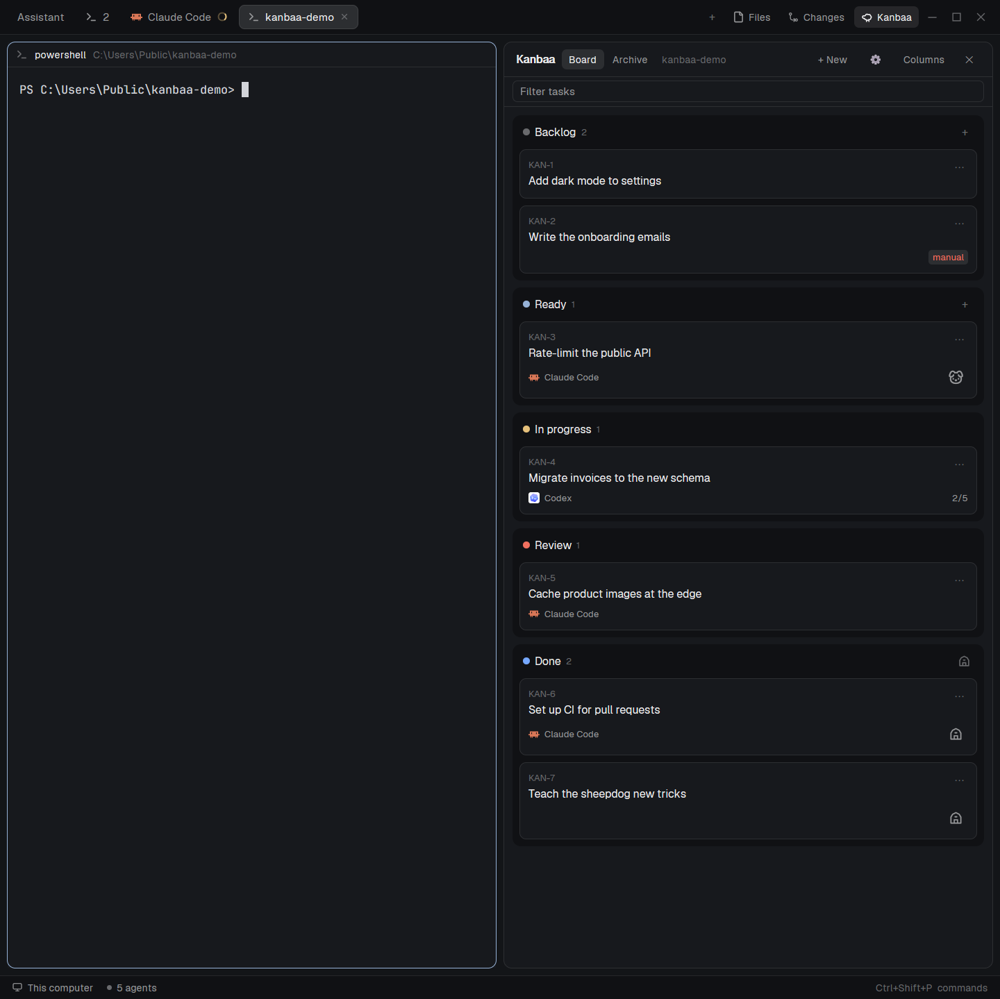

# Kanbaa

A to-do board for [Herdr](https://herdr.dev), beside your terminals. It shows the Markdown files in a repo's `to-do` folder as cards in five statuses, lets you move them, put an agent on one, and send that agent after it in a new tab. A repo without a `to-do` folder gets one with its first task. The files are the only state and they live in your repo, on your machine: nothing is stored anywhere else, so you, your agents, your editor and git all look at the same tasks.



The layout is Herdr's own with one column added: the sidebar with Spaces and Agents, the tab bar, Files, Changes and the status bar are all Herdr's, unchanged. In the picture, the names of the spaces and agents in the sidebar are blurred.

## Who it is for

Kanbaa is for people who want to stay in charge of their work. You write the backlog, you decide what is Ready, and an agent starts on a task when you send it: unless you change the setting, the board asks first. No task list is kept out of sight. Agents create tasks only if you turn that on, and what they create is the same Markdown file on the same board as yours, where you can read it, change it or delete it.

It suits smaller projects, where a backlog should take a folder and not a service. Everything can be done on the board: add a task, order it, hand it to an agent, read the result, send it back. The terminal stays open to you all the same, since the tasks are files to edit and there is a script to call.

## How it works

Kanbaa is a sheepdog for your to-do folder. The tasks are the flock, the five statuses are the pens, and the board's job is to show you who is standing where. It owns no sheep: every task is a plain Markdown file in your repo, and the board is a window onto them.

```
to-do/KAN-3-rate-limit-the-public-api.md

  # Rate-limit the public API        <- the title on the card

  **Status:** Ready                  <- which pen it stands in
  **Agent:** claude                  <- who gets sent after it

  Limit each key to 60 requests      <- the description, as long
  a minute and answer 429 above.        as you like
```

**A file is a card.** Drop a `.md` file into `to-do/` and a card appears. Delete the file and the card is gone. There is no database, no account and no sync, because there is nothing to sync.

**Moving a card is editing one line.** Pick another status from a card's `⋯` menu and Kanbaa rewrites the `**Status:**` line and leaves every other byte alone. Move the card back and `git diff` is empty. It works from the other side too: change that line in your editor, or let an agent change it, and within ten seconds the card has walked to its new pen.

**Ready is the gate.** Give a card an agent and move it to Ready, and Kanbaa asks "Send Claude Code after KAN-3?". Say yes and it writes `In progress` into the file and opens a new tab where that agent starts on the task. Cancel and nothing happens. A file that says "Manual pickup only" is never offered: that sheep is yours.

**The agent herds its own card.** When the work is finished the agent writes what it did under `## Result` in the task file, sets the status to `In review`, and stops. You open the card, read the result and the files it names, and choose: **Mark as done**, or **Send back** with a note, which lands in the file under `## Feedback` and is passed to the agent if it is still there.

**Done tasks go to the barn.** Archive a finished task and it leaves the board for the Archive view, where it can be restored. The file stays where it was.

Since it is all files, whatever works on files works on your board: git history is the audit log, and a pull request can carry its own task along.

## What you get

- Five statuses (Backlog, Ready, In progress, Review, Done), side by side or stacked, each collapsible.
- Task ids from the repo's name (`KAN-12`), in the file name, never reused.
- A detail view where the title, description, status, agent and pickup edit in place and save themselves.
- A result block and file links for review, with Send back and Mark as done.
- Search across ids, titles, agents and text; ▲ and ▼ to order a status.
- An archive, by hand or by itself after an hour, a day or a week.
- A script and a skill so that Claude Code, Codex and Hermes can create and move tasks themselves.

## Install

Kanbaa is a Herdr layout. In Herdr, ask your agent to add it from this repository. It copies `layouts/kanbaa.json` and the three folders under `mods/` into your Herdr home and switches to the layout; your own layout stays as it is, and `ctrl-shift-l` switches between them. [RECIPE.md](RECIPE.md) is the full brief an agent builds or checks it from.

Then press the Kanbaa button (the sheep) in the tab bar, in a repo that has a `to-do` folder, or make your first task with `+ New`.

It needs Herdr 0.1.15 or later and git. [Node.js](https://nodejs.org) is needed only for the task script and for telling agents about it; the board itself runs without.

## Agents and tasks

The first time the board opens, its settings offer to tell your agents how to create and move tasks. Nothing is installed until you tick an agent and press Apply. What they then use is one script:

```sh
node task.mjs new --title "Fix the login bug" --description "Users are logged out after a refresh."
node task.mjs move KAN-12 review
```

It lives in `mods/kanbaa/` and shares its code with the board, so a task an agent creates is the same file, with the same kind of id, as one you make with `+ New`.

## What it does on your machine

Kanbaa is a Herdr mod, and Herdr mods are trusted code. So that nothing comes as a surprise:

- It reads the `to-do` folder of the repo you are looking at, and writes, creates and deletes Markdown files there when you move, edit, add or delete tasks.
- It runs `git`, and PowerShell or `sh`, to find the repo and list that folder.
- It keeps one small counter of the ids it has handed out, in the repo's `.git` folder.
- It opens a tab for an agent you send after a task, types one line into that agent's terminal when you send its task back, and closes its tab when you mark the task done.
- Only if you ask it to in the settings, it writes a skill into `~/.claude/skills` or Hermes's skills, or a marked section into `~/.codex/AGENTS.md`, and removes them again when you untick them.

It makes no network requests.

## Good to know

- It has been built and used on Windows. The paths for macOS, Linux and remote machines are written but have not been run.
- Every agent you start works in the repo's one working tree. Kanbaa tells you when a second one would start while the first is still working; it does not give each task its own worktree.
- The spinner, the link to an agent's tab, Send back's message and Mark as done's closing only know agents the board itself started.
- Task ids are counted per repo on one machine. Two clones of the same repo count apart.

## Credits

The sheepdog on the Start button is the "dog" icon from [Lucide](https://lucide.dev), under the ISC License. The barn and the sheep were drawn for Kanbaa.
