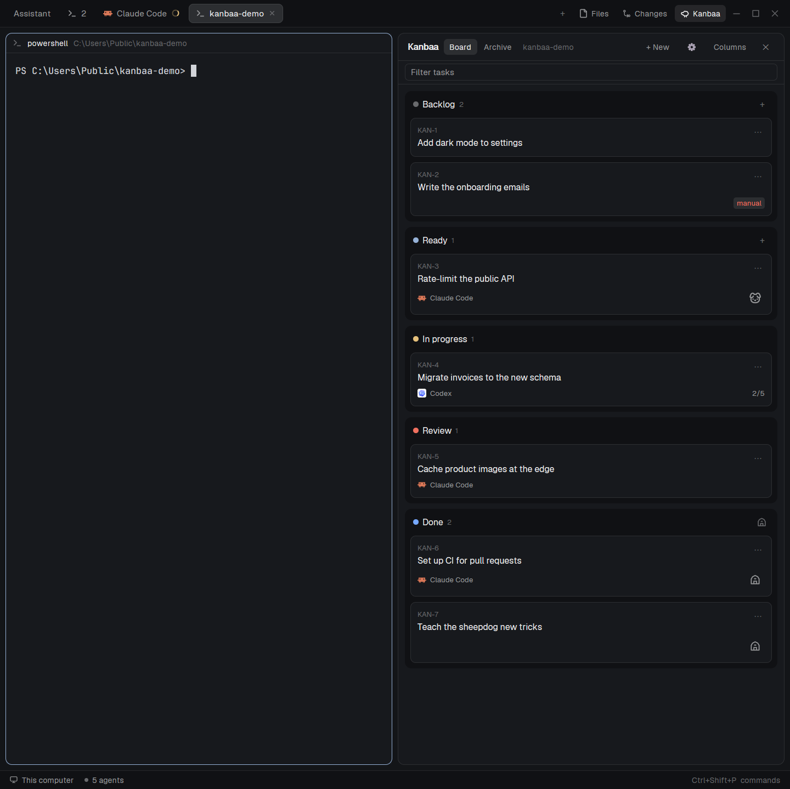

# Kanbaa

A Herdr layout with a to-do board beside your terminals: Herdr's own layout plus one column. Kanbaa reads the to-do folder of the repo you are working in and shows every Markdown file there as a card. You move cards between five statuses, assign an agent, and send that agent after a task in a new tab. The files are the only state: the board stores nothing of its own, so agents, editors and git all see the same tasks.



## What you see

Everything except the board is Herdr's shipped `main` layout. Left to right, on the theme's `canvas`:

- **Sidebar**, 268px, `chrome` background: the Herdr brand row (46px), then Spaces and Agents sharing the height, then the settings footer (69px). In the preview picture its names are blurred.
- **Work area**, a column:
  - **Tab bar**, 42px: tab pills, a `+` menu, then three toggles on the right: Files, Changes and Kanbaa (a sheep).
  - **Body**, 8px padding and 8px gaps, a row of up to three cards with 10px corners and a 1px border:
    - the active tab's terminals, each pane with a 30px header;
    - **Kanbaa**, hidden until its button is pressed, sharing the width with the terminals (minimum 320px);
    - **Files / Changes**, 368px, hidden until toggled.
  - **Status bar**, 28px.

Kanbaa itself, top to bottom:

- A 42px header: "Kanbaa", two views as pills (Board, and Archive with its count), the folder name in `dim`, then `+ New`, a `⚙`, a `Rows`/`Columns` toggle and `✕`.
- A 36px row with the search field ("Search tasks"), then a pill per type (Bug, Feature, Chore, Research, Docs); while either filters, a count ("1 of 9") and Clear beside them.
- Five statuses, each a `chrome` block with 10px corners: a colored dot (`dim`, `accent`, `working`, `blocked`, `done`), the name, a count. **Backlog, Ready, In progress, Review, Done.** Backlog and Ready have a `+` on the right of their title, Done a small barn (archive them all).
- Cards on `surface`, 8px corners: the id in 10.5px `dim` (`KAN-4`), the title, ▲ and ▼ (not in Done), a `⋯`. Under it a small line with the type as a chip in its colour (Bug `blocked`, Feature `accent`, Chore `muted`, Research `working`, Docs `done`), the agent's icon and name, a spinner while that agent works, a checkbox count such as `2/5`, a red `manual` tag when the file is gated, and bottom right one button: a sheepdog on a card that can be started, a check on one in Review (Mark as done), a barn on a done one.
- An empty Backlog says "Nothing in the baacklog".
- Everything that opens (a task, New task, Send back, the settings, a question) is a panel over the dimmed board, inside its outline.

## How it behaves

- **Following you.** The board shows the repo of the focused pane: its git top level, then the first of `to-do`, `todo`, `docs/to-do`, `docs/todo` that exists, its `*.md` and one level of subfolders. `README.md` and names starting with `_` are skipped; 200 files at most (past that, the ones changed last). It refreshes when the folder changes and every 10 seconds, and not at all while hidden.
- **Status of a file**, first found wins: a `**Status:**` line in the first 30 lines, `status:` in frontmatter, a subfolder named `backlog`, `ready`, `in-progress` or `completed`, the checkboxes (none ticked, some, all), else Backlog. "Review" anywhere in the status wins, so "Done, pending review" is Review.
- **Rows or columns.** The header toggle stacks the statuses or puts them side by side (110px minimum each). Clicking a status title collapses it: to its title line in rows, to a 34px strip with the title turned a quarter in columns. Both are remembered.
- **Moving and assigning.** `⋯` or a right-click on a card opens a menu: the other statuses, the installed agents and Unassigned, each under its own heading. A choice rewrites one line of the file (`**Status:**` or `**Agent:**`, or the frontmatter keys when the file uses them) and leaves every other byte alone, line endings included.
- **Dragging.** A card can also be dragged: press it, move, let go. The dragged card dims and a small copy of it (id and title) follows beside the pointer; an accent line on a card's top or bottom edge shows where it would land, and a status with no line lights up and takes it at its end. A drop on another status writes the Status line as the menu does (so a drop in Ready with an agent asks, as above); a drop beside a card also writes the Order lines, the dragged card's status and place in one write. Done takes a card but gives it no place, and a drop there is Mark as done (below): the agent's tab closes. Until the pointer has moved 4px the press is a click and opens the card. Esc, leaving the board or letting go anywhere else cancels. A long column does not scroll while you drag. Not in the Archive, and not on a read-only board.
- **Order.** Done and the Archive list the task finished last on top (by the file's last change) and have no controls for it. In the other statuses, cards go by id until you place them. Each card has ▲ and ▼ for one place up or down (the top card has no ▲, the bottom one no ▼). A place is an `**Order:**` line in the card's file (lower first); the first ▲, ▼ or drop in a status numbers all of its cards.
- **Search.** A field under the header: every word typed must be in a task's id, title, agent or text. The board and the Archive follow as you type, with a count of what is left and a Clear button; Esc clears it too.
- **Opening a card** dims the board and shows a panel inside it, up to 760px wide and always clear of the board's edges: id, title, status, agent and pickup, the file's other header lines, and the description in a box as tall as its text (84px at least; a long text gets a 260px scrolling box). Everything on it edits in place and saves itself. A click on the title or the description puts a field there; what is typed is written a moment after the last key, on Enter in the title, and when the field loses the keyboard. A click on status, agent or pickup opens its choices, and picking one writes at once. **Start** (on a task in Backlog or Ready with an installed agent) asks, then sends the agent. **Delete** asks, then removes the file.
- **New task** (`+ New`, or the `+` on the Backlog and Ready titles, which presets that status) opens the same kind of panel: title, description, status, agent, pickup. The agent starts as the one chosen in `⚙` for new tasks, if any. It writes `to-do/<ID>-<title-slug>.md` and never overwrites. A task made Ready with an agent counts as landing in Ready (see Starting an agent). The id is the repo's first three letters and the next free number (`KAN-8`); it lives in the file name only and is never editable.
- **Starting an agent.** A card that can be started (Backlog or Ready, an installed agent, no manual notice) has a small sheepdog on it; so does its opened panel. Moving a card with an installed agent to Ready, or assigning one to a card already there, asks "Send Claude Code after KAN-3?" (in `⚙` this can be set to send the agent right away, or to do nothing; the sheepdog and Start always ask). If another agent is still working in the same checkout, the question says so, and "right away" asks instead of starting: every started agent works in the repo's one working tree. Confirming first writes `In progress` to the file, and only if that write lands opens a tab in the repo root running that agent with a prompt naming the file. You land in that tab, unless `⚙` is set to stay on the board, which selects the tab you were on again. Cancel changes nothing. A card in Ready also has Start in its menu.
- **Type.** A task can say what kind of work it is: a `**Type:**` line under `**Status:**` (`type:` in frontmatter), one of Bug, Feature, Chore, Research or Docs (kept in `parse.js` as `TYPES`, read without regard to case). The card's menu has a Type heading, the opened task and the New task panel a Type choice; None removes the line. A value the board does not know stays in the file and shows with the other header lines in the opened task. The pills beside the search field show only one type's cards, on the board and in the Archive; a second click, Clear or Esc shows them all again. Search matches the type too, and `task.mjs new --type bug` writes it from a shell.
- **Model.** A task can name the model its agent is started on: a `**Model:**` line under `**Agent:**` (`model:` in frontmatter), which the board adds to the agent's start command as `--model <id>` for Claude Code and `-m <id>` for Codex and Hermes. Other agents get no model. The New task panel and the opened task show a Model choice once such an agent is chosen: Default, then that agent's models (Claude Code's aliases `fable`, `opus`, `sonnet`, `haiku`, kept in `parse.js`; Codex's from its own `~/.codex/models_cache.json`, read once on this machine), and in the New task panel a field to type any other id. Default writes no line. `⚙` has a default model per installed agent that has a list, in its Default models section; a task's own line wins over it, and with neither the agent starts on its own default. Choosing another agent removes the Model line. Only what looks like an id counts (letters, digits and `. : / @ [ ] - _`, never a leading dash), since the value becomes an argument of a command. The card shows the model after the agent's name, and the question names it: "Send Claude Code (opus) after KAN-3?". An agent that is already running keeps its model.
- **A task and its agent.** When the board starts an agent, it labels that agent's terminal with the task file's path (`kanbaa.task`). Everything that concerns "this task's agent" goes by that label: it survives a renamed tab, a retitled task and a restart of Herdr, and names one terminal only. If a labelled terminal goes away while its task is in Review, a toast asks "KAN-3: its agent has closed. Click to mark the task Done"; ignoring it leaves the card in Review.
- **Result for review.** An agent that finishes adds a `## Result` section to the task file: a few lines on what it did and the files it made, each path in backticks. A longer write-up goes in a `## Details` section above it (`## Research` and `## Review` are read the same way). Once the task is in Review, the opened task shows, under the description, that text in its own box, as tall as its text, then those files, then a folded "▸ Details" row that opens the write-up in place. With Details open or a long result, the panel takes the board's height and scrolls between its title and its actions. The start prompt and the skill also tell the agent to bring the Result up to date whenever it is asked for more in its terminal afterwards. The description is then shown and edited without those sections, which stay the agent's; a click shows the file in the result's box (Markdown rendered, anything else as text), and "← Result" goes back. The task's own file is left out of the list. They are shown, never opened with the system's programs.
- **Archive.** The header has two views, Board and Archive. A done card has an archive button, and the Done title has one for all done tasks at once (asked first). Archiving writes `**Status:** Archived`: the file stays where it is and only leaves the five statuses. The Archive view lists those tasks, each with Restore (back to Done). In `⚙`, done tasks can be archived by themselves after 1 hour, 1 day or 7 days, counted from the last change to the file and done while the board is open.
- **Send back.** The other button on an opened task in Review. It asks what should change (optional; Enter in the field sends, like the button), adds that as a dated line under `## Feedback` in the task file and moves the card to In progress. An agent whose tab is still there and at rest (idle or done) gets a line typed into its terminal (`hc send`) telling it to read the feedback; a busy one is not typed to, and a toast says so. You stay on the board unless `⚙` is set to take you to the agent's tab. If the tab is gone, it asks whether to send a new agent, whose prompt points at the feedback.
- **Mark as done.** An opened task in Review has it, and so does its card on the board (the check, bottom right): it writes Done, closes the tab of the task's agent and closes the panel. If that agent is still working, it asks first. Every other way to Done does the same: the menu's Done, the opened task's status, a card dropped on Done.
- **Going to the agent.** While the terminal of a task's agent exists, the agent's name on the card is a link to its tab, and the opened task has a "Reply in terminal" button among its actions that does the same.
- **Reply.** A card whose agent is stopped on its own dialog (a permission, a question; Herdr's `blocked`) says "needs you" in the `blocked` color; one whose agent is at rest while the task is still In progress says "waiting" in `dim`, or "hit a limit" in the `blocked` color when the last lines of its screen say it stopped on a usage limit (the board reads that screen once per rest with `hc read` and matches the wording, `hitLimit` in `parse.js`; Herdr reports no status for it). All get a Reply button. The opened task has "Reply in terminal" whenever its agent's terminal is there, working or not, and it says why when the agent waits ("Reply in terminal: needs you", ": hit a limit"). Both take you to that agent's existing terminal tab: you answer in the terminal itself, with the agent's real choices. The board types nothing for you here.
- **Still working.** A card whose agent's terminal is still working shows a small spinner, whatever status the file says. An agent sets `In review` as its last action and then still prints its summary, so a card whose file says Review while its own agent is working stays under In progress, marked "finishing", and moves to Review when the agent comes to rest. A reply typed in that agent's terminal while the task waits in Review does the same: the card is back under In progress (spinner, no "finishing") while the agent works on it, and returns to Review when it rests. Only the place on the board differs: the file says Review all along.
- **Manual only.** A file with "Manual pickup only" in its first 30 lines shows the `manual` tag and is never offered Start. The pickup dropdown adds or removes that line.
- **Questions stay in the board.** New task, an opened task, the settings and every "Send…?" or "Delete…?" question are panels inside the board's outline, never app dialogs. A panel taller than the board scrolls within it, and Esc closes whatever is open, one layer at a time.
- **Stale files.** Every write names the text it was read from. If the file changed on disk meanwhile, nothing is written, a toast says so and the board reloads.
- **Other machines.** On a space on another machine the board is read-only: no `⋯`, no New, no Edit.
- **Settings.** The first time the board has something to show, and from `⚙` after that, a panel with headed sections, each choice a row of pills that saves as you pick: **Starting tasks** (what happens when a task with an agent lands in Ready: ask first, send right away, do nothing; after sending an agent: stay on the board or go to its tab), **New tasks** (the agent a new task starts with), **Default models** (a row per installed agent that has a list of models, a dropdown headed "Default model for Claude Code": Default, then its models; shown only when there is such an agent), **Review** (after Send back: stay on the board or go to the agent's tab), **Archive** (archive done tasks never, or after 1 hour, 1 day, 7 days), **Updates** (check for new versions: off, the default, or on; see Updates below) and **Agents** (tick Claude Code, Codex and Hermes to tell them how to create and move tasks). Only that last section writes outside the board, and only on "Apply to agents", a button that shows while the ticks differ from what is installed; unticking and applying removes it again.
- Agent statuses (working, blocked, done, idle) are shown by the sidebar and the tab pills, as in Herdr's own layout. On the board they show only through an agent it started: the spinner while it works, and the link to its tab. The agent still moves its own card, by editing the file.

## Built from

`layouts/kanbaa.json` is Herdr's `main.json` with two changes: the `tabs` block shows `kanbaa-tabs`, and `work-body` has a `board` block after `main`.

```
root (row, canvas, titlebar none, divider 1px border, terminal_padding [14, 12])
├─ sidebar (column, 268px, min 44, max 480, chrome, not resizable)
│  ├─ brand            workspace-chrome, 46px, window_drag
│  ├─ sidebar-lists    spaces + agents, weight 1 each, min 90
│  └─ sidebar-footer   workspace-chrome { footer: true }, 69px
└─ work (column, not resizable)
   ├─ tabs             kanbaa-tabs, 42px, window_drag
   ├─ work-body (row, padding 8, gap 8)
   │  ├─ main          { tab: "active" }, pane header `pane` 30px top always, radius 10, gap 8, lone
   │  ├─ board         kanbaa, weight 1, min 320, max 1400, hidden
   │  └─ panel (column, 368px, min 280, max 900, hidden)
   │     └─ panel-body (stack)  files: files · changes: changes
   └─ status           workspace-status, 28px
```

Mods in this repo:

- `kanbaa`: the board. `main.js` (the view), `parse.js` (reading and rewriting task files, no Herdr imports), `form.js` (New task), `setup.js` (the settings panel), `ui.js` (the shared dropdowns), `label-*.svg` (the turned titles), `dog.svg` (Lucide, ISC) `archive.svg` (a barn, drawn for Kanbaa) and `done.svg` (a check, drawn for Kanbaa), `send-back.js` (typing a send-back note into an agent's terminal), `parse.test.js` and `send-back.test.js` (`node --test`), `jsconfig.json` (editor settings; `gpui-kit.d.ts` next to it is regenerated on every run and not kept in git).
- `kanbaa/task.mjs`: a Node script for agents, with the same code as the board: `new` creates a task, `move <ID> <status>` moves one. `kanbaa/install-skill.mjs`: installs `skill/SKILL.md` into `~/.claude/skills/kanbaa-task`, into Hermes's skills when asked, and, when asked, `skill/AGENTS.md` between two marker lines in `~/.codex/AGENTS.md`, with the real path to `task.mjs` filled in.
- `kanbaa-tabs`: a clone of the shipped `tabs` (0.1.15) with one addition, the Kanbaa toggle (`layout.toggle { id: "board" }`).
- `status-menu`: the small popup Kanbaa's card menu uses. Props `{ items }`, each `{ label, current?, hint?, indent?, action: [command, args] }` or `{ header: true, label }` for a section title; picking an item runs its command.

Shipped mods used as they are: `workspace-chrome`, `spaces`, `agents`, `pane`, `files`, `changes`, `workspace-status`, `new-menu`, `menu`, `toast`.

From `herdr`: `spaces`, `panes`, `focused`, `agents`, `terminals`, `layout`, `theme`, `window`, `appHome`, `exec`, `readTextFile`, `writeTextFile`, `watchFolder`, `knownAgents`, `hc`, `openOverlay`, `notify`, `nextCommand`, `setShared`, `run`. Commands: `layout.hide`, `layout.toggle`, `tab.new { name, folder, argv, task }`, `pane.focus { pane }`, `space.select { id }`, `tab.select { id }` (Reply and terminal links), and `kanbaa.pick-<n>`, the way a menu choice comes back to the board.

Programs it runs: `git rev-parse`, `git ls-remote` (only with Updates on), `powershell` (Windows) or `sh` to list the to-do folder, `powershell Remove-Item` or `rm` to delete a task, `cmd /c mkdir` or `mkdir -p` for a first to-do folder, `node` for the setup panel, and `hc label` and `hc send` (through `hc()`) to label an agent's terminal and to tell it a task came back.

## Watch out

- **Tell the person before installing.** Kanbaa runs programs, writes and deletes Markdown files in the repos you open, types into the terminal of an agent it started (Send back), closes that agent's tab (Mark as done), and its settings can write into `~/.claude`, `~/.codex` and Hermes's skills. Do not run `install-skill.mjs` for them: which agents are told is their choice, made in `⚙`.
- **Only agents the board started are known to it.** The spinner, the link to the agent's tab, the hold under In progress, Send back's message and Mark as done's closing all go by the label the board puts on a terminal it started. An agent pointed at a task by hand has none: its card still moves, by the file.
- **Updates.** An install keeps the commit it was copied at in `mods/kanbaa/version.json` (`{ "commit": "<sha>" }`), written by whoever installs or updates it; the repo has none (it is in `.gitignore`), since a file cannot hold its own commit. With Updates on in `⚙`, the board runs `git -c credential.helper= ls-remote https://github.com/softspike-io/kanbaa HEAD` (15 s timeout) when it refreshes, at most once a day, and each time `⚙` opens, and compares. `⚙` shows Up to date, Update available (and a dot on the `⚙` button), or that the install records no version. The last two offer **Update with <agent>** (the New tasks agent, else the first installed one), which opens a tab in Herdr's folder with `parse.js updatePrompt()`: the agent clones the repo, reads the diff, follows "Layouts and mods other people made", asks before replacing a file the person changed, and writes the new `version.json`. The board writes no file for an update. That is the only network use, and it is off by default.
- **Node is optional for the board, required for the rest.** Without `node` on the PATH the setup panel says so and `task.mjs` cannot run. The board itself works.
- **Only tried on Windows.** The `sh` paths for macOS, Linux and remote machines are written but have not run. The turned titles are outlines of Segoe UI Semibold; a renamed status needs its `label-<id>.svg` redrawn, since mods cannot rotate text.
- **`kanbaa-tabs` is a clone**, so it does not receive Herdr's later fixes to `tabs`. To add the board to another layout instead, keep that layout's tab bar and give it one button that runs `layout.toggle { id: "board" }`.
- **Renaming the mod.** `main.js` and `setup.js` name `mods/kanbaa/` and the `kanbaa.pick-` commands; a `mod.clone` rewrites the first, check the second. The skill needs no edit: run `install-skill.mjs` again and it writes the new path.
- **The `board` id.** The Kanbaa toggle, the ✕ and the "don't refresh while hidden" check all look for a layout node with id `board`.
- **Open in Preview.** A card's panel offers it only in a layout that has a node with id `preview` showing a mod that reads shared `"preview.file"` (`{ path, on }`). This layout has none.
- **Drag and drop is made by hand.** Herdr has none for a mod's own elements: the board keeps the press in `this.drag` and follows `on_mouse_move` (which carries no button state and only arrives over the element under the pointer) to `on_mouse_up`, as the shipped Spaces sidebar does. A release outside the board is never seen, which is why leaving it cancels. The menu and ▲ ▼ do the same moves without it. A menu can only run a command, so the board keeps its pending choices in `this.picks` and listens with `nextCommand()`.
- **Input states** (`InputState.new`, `TextareaState.new`) must be made in `init` or an event handler, never in `render`.
- **Ids are counted per repo, on one machine.** The highest number handed out is kept in git's own folder (`<git dir>/kanbaa-ids.json`, shared by every worktree of the repo, never a change to commit), next to the tasks outside git. A deleted task's id is not given again. Two clones of a repo still count apart.
- **A description that opens with a `**Key:**` line** is read as part of the header and shown with the fixed facts.
- **Limits.** 200 task files (the ones changed last), the first 30 lines for status, agent and the manual notice, files up to 1 MiB.

## Done when

- `node --test mods/kanbaa/parse.test.js` passes, and `herdr-app check` passes for `mods/kanbaa` and `mods/kanbaa-tabs`.
- `layout.switch { name: "kanbaa" }` shows the layout with no `layout.error`.
- The Kanbaa button opens the column next to the terminals; Files can be open beside it; ✕ closes it and it stays closed after a restart.
- In a repo with a `to-do` folder, each `.md` file is a card in the status its file says.
- Moving a card and back leaves `git diff` empty; in between it shows only the status line.
- `+ New` creates `to-do/<ID>-<slug>.md` with the next number, and the card appears.
- Editing a title or description changes only that part of the file.
- Moving a card with an agent to Ready asks first; Cancel starts nothing; Confirm opens one tab in the repo root and the file says `In progress`.
- With `⚙` set to stay on the board, sending an agent opens its tab and leaves you on the tab you were on.
- A file with "Manual pickup only" on top is never offered Start.
- Typing in the search field leaves only the cards that hold every word; Esc brings them all back.
- Picking Bug as a task's type writes `**Type:** Bug` under its Status line and shows a red Bug chip on its card; the Bug pill then shows only that kind of card.
- ▲ on the second card of a status makes it the first, and the files of that status each carry an `**Order:**` line.
- Dragging a card onto another status moves it there (`git diff` shows its status line, and Order lines when dropped beside a card); dragging it within its status changes only Order lines; a press and release without moving still opens the card; Esc during a drag changes nothing.
- A task whose file ends with a `## Result` section shows that text under the description, and its files as links, when opened in Review; a `## Details` section above it is folded under the result and not in the description.
- Send back with a note adds a dated line under `## Feedback` and puts the card under In progress; Mark as done writes Done and closes the agent's tab.
- The barn on a done card writes `**Status:** Archived`; the card is then in the Archive view, and Restore brings it back.
- `node mods/kanbaa/task.mjs new --title "Try it"` inside a repo prints an id and a path, and the card appears; `move <that id> review` moves it.
- In the setup panel, ticking Claude Code and Apply creates `~/.claude/skills/kanbaa-task/SKILL.md`; unticking and Apply removes it.
